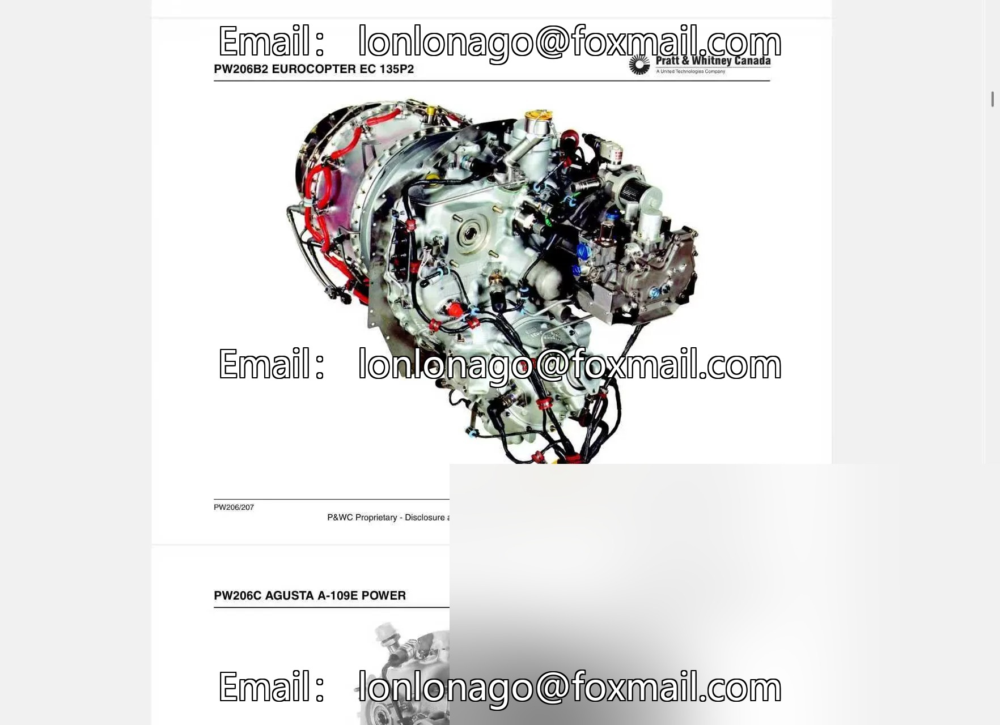

# Content: PWC PW206-207 engine materials, including engine structure,

## Body

Content: PWC PW206-207 engine materials, including engine structure, performance parameters, maintenance tutorials, etc., suitable for professional study of aviation engines and reference for repair.
II. Material format: , PDF format, content complete.
III. Material source: produced by authoritative institutions, materials reliable.
IV. Material attributes: copyable, not refundable after sale.

The materials include engine structure, performance parameters and maintenance tutorials in PDF format; they come from a authoritative agency, are reliable, and can be copied while being sold with a return policy.

<!-- AI_ENRICHED -->

## Images

## Payment

Here is a pay link on Stripe ( https://buy.stripe.com/3cs8yP7sY87d0vu9AB ). Please contact me lonlonago@foxmail.com after funding $89, and I will send you a complete data files , thank you!

